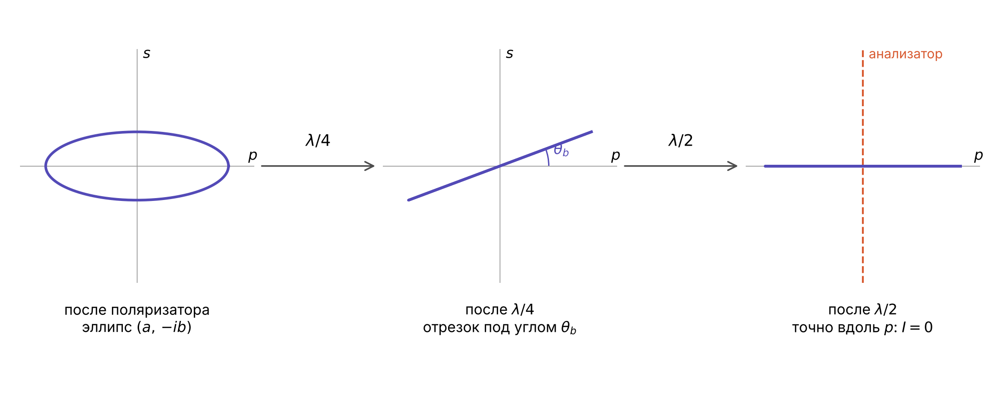
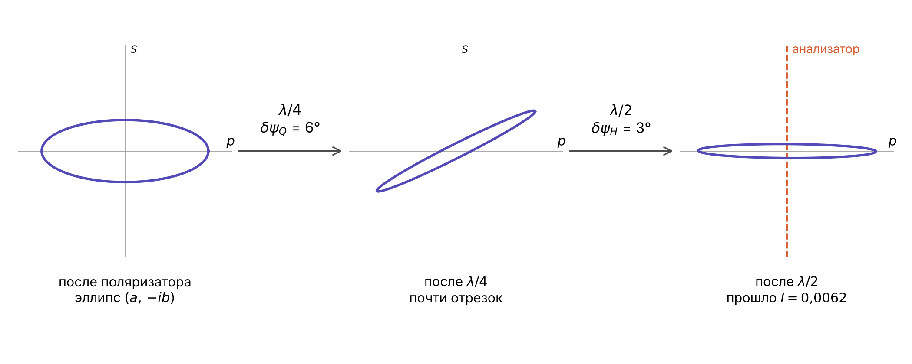
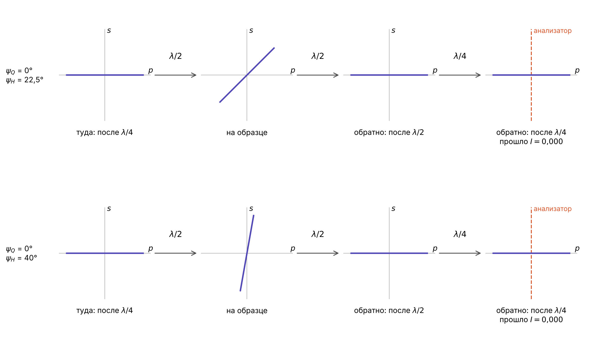
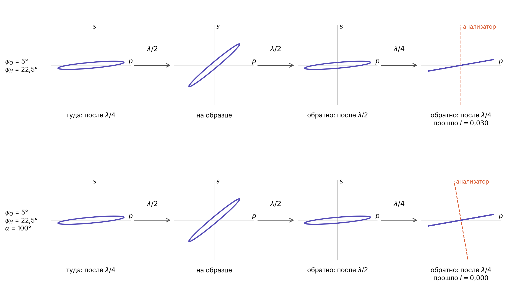

# polarization_figures

Картинки поляризации для кросс-поляризационной схемы с парой волновых пластин λ/4 + λ/2.

Скрипт считает поле матрицами Джонса и рисует кривую, которую описывает конец вектора E за период.

## Схема 1: пластины между поляризатором и анализатором (один проход)

`scheme1_ideal` — идеальные пластинки



`scheme1_errors` — пластинки с ошибками установки δψ_Q и δψ_H



## Схема 2: пластины между светоделителем и образцом (двойной проход)

`scheme2_ideal` — накачка вдоль p проходит λ/4 и λ/2 к образцу и обратно



`scheme2_errors` — λ/4 стоит с ошибкой δψ_Q



## Запуск

```
pip install -r requirements.txt
python polarization_figures.py
```
